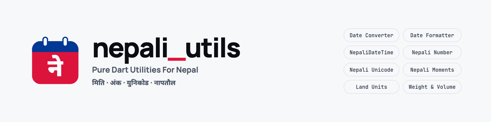

<div align="center">

<picture>
  <source media="(prefers-color-scheme: dark)" srcset="https://raw.githubusercontent.com/sarbagyastha/nepali_utils/develop/assets/nepali-utils-banner-dark.png">
  
</picture>

[](https://pub.dev/packages/nepali_utils)
[](https://pub.dev/packages/nepali_utils/score)
[](https://pub.dev/packages/nepali_utils/score)
[](https://github.com/sarbagyastha/nepali_utils/blob/develop/LICENSE)
[](https://nepali-utils.sarbagyastha.com.np)

[📖 **Documentation**](https://nepali-utils.sarbagyastha.com.np) &nbsp;·&nbsp;
[🚀 **Getting started**](https://nepali-utils.sarbagyastha.com.np/getting-started/installation/) &nbsp;·&nbsp;
[🔄 **Migrating from 3.x**](https://nepali-utils.sarbagyastha.com.np/migration/v4/)

</div>

---

`nepali_utils` is a pure Dart package for everything Nepali. It handles **Nepali dates** in the **Bikram Sambat (BS)** calendar, with fast and accurate **AD to BS and BS to AD conversion** and a time-zone aware `NepaliDateTime`. It provides an intl-compatible **Nepali date format** and **Nepali number format**, with lakh/crore grouping, currency, compact numbers (`12.3L`) and **number to words**. It converts **Romanized text and Preeti to Nepali Unicode** (Devanagari), and formats **relative time** ("3 days ago" / "३ दिन पहिले"). It converts land and weight units such as **ropani, aana, bigha** and **tola**, and handles **Nepali phone number validation** with **Nepal Telecom / Ncell** operator detection. Every feature works in English and Nepali, and it runs anywhere Dart runs: Flutter, server and web.

## ✨ Features

| | Feature | |
|---|---|---|
| 📅 | **NepaliDateTime**: a BS `DateTime` with AD ↔ BS conversion, local/UTC/Nepal time zones, arithmetic and parsing | [Docs →](https://nepali-utils.sarbagyastha.com.np/guides/date-time/) |
| 🗓️ | **NepaliDateFormat**: intl `DateFormat` patterns and skeletons with Nepali month and weekday names | [Docs →](https://nepali-utils.sarbagyastha.com.np/guides/date-format/) |
| 🔢 | **NepaliNumberFormat**: lakh/crore grouping, currency (`रु.`), percent, compact, number to words and parsing | [Docs →](https://nepali-utils.sarbagyastha.com.np/guides/number-format/) |
| ⏱️ | **NepaliMoment**: relative time, durations and calendar phrases (`हिजो`, `Today at 9:04 PM`) | [Docs →](https://nepali-utils.sarbagyastha.com.np/guides/moment/) |
| 🔤 | **NepaliUnicode**: Romanized → Unicode (classic, Google and MPP styles), and back with `toRoman` | [Docs →](https://nepali-utils.sarbagyastha.com.np/guides/unicode/) |
| 🅿️ | **Preeti & Devanagari**: Preeti ↔ Unicode, Devanagari digits, detection and akshara splitting | [Docs →](https://nepali-utils.sarbagyastha.com.np/guides/preeti-devanagari/) |
| 📐 | **NepaliArea / NepaliWeight / NepaliVolume**: ropani-aana-paisa-daam, bigha-kattha-dhur, tola-lal, muri-pathi-mana | [Docs →](https://nepali-utils.sarbagyastha.com.np/guides/measurement/) |
| 📞 | **NepaliPhoneNumber**: validate, format and find Nepali mobile and landline numbers, with the operator or district | [Docs →](https://nepali-utils.sarbagyastha.com.np/guides/phone-number/) |

## 📦 Install

```sh
dart pub add nepali_utils   # or: flutter pub add nepali_utils
```

Requires Dart 3.13 or later.

## 🚀 Quick taste

```dart
import 'package:nepali_utils/nepali_utils.dart';

void main() {
  // AD ↔ BS conversion and formatting
  final bs = DateTime(2019, 5, 14).toNepaliDateTime(); // 2076-01-31
  NepaliDateTime(2081, 1, 1).toDateTime(); // 2024-04-13
  NepaliDateFormat.yMMMMEEEEd(Language.nepali).format(bs); // २०७६ बैशाख ३१, मंगलबार

  // Numbers
  NepaliNumberFormat.simpleCurrency().format(1234567); // Rs. 12,34,567.00
  NepaliNumberFormat.compact().format(1234567); // 12.3L
  NepaliNumberFormat.words(language: Language.nepali).format(123456);
  // एक लाख तेइस हजार चार सय छपन्न

  // Text, relative time, units and phone numbers
  const NepaliUnicode().convert('mero naam {Sarbagya} ho'); // मेरो नाम Sarbagya हो
  Preeti.toUnicode('g]kfn'); // नेपाल
  NepaliMoment().format(DateTime.now().subtract(const Duration(days: 3))); // 3 days ago
  NepaliArea.ropani(2, aana: 3, paisa: 1).format(.ropani); // 2-3-1-0
  NepaliPhoneNumber.parse('+977 ९८४१२३४५६७').operator?.label(); // Nepal Telecom
}
```

Set the default language once with `NepaliUtils.defaultLanguage = Language.nepali`, or pass a `language` to any formatter. Try everything in the browser with the [Nepali Utils web app](https://nepali-utils.sarbagyastha.com.np/tool/) ([source](https://github.com/sarbagyastha/nepali_utils/tree/develop/example)), and see the [guides](https://nepali-utils.sarbagyastha.com.np) for much more.

## 🔄 Upgrading from 3.x?

> [!IMPORTANT]
> 4.0 is a major rewrite. Some changes are silent, for example `NepaliDateTime.now()` now returns local time, and numbers are rounded instead of truncated.
> Read the **[migration guide](https://nepali-utils.sarbagyastha.com.np/migration/v4/)** and the [changelog](https://pub.dev/packages/nepali_utils/changelog) before upgrading.

## 🤝 Contributing

Bug reports, ideas and pull requests are welcome on [GitHub](https://github.com/sarbagyastha/nepali_utils/issues). Please run `dart analyze` and `dart test` before you open a PR. The documentation site lives in [`docs/`](https://github.com/sarbagyastha/nepali_utils/tree/develop/docs) and uses Starlight.

## 📄 License

[MIT](https://github.com/sarbagyastha/nepali_utils/blob/develop/LICENSE) © Sarbagya Dhaubanjar
